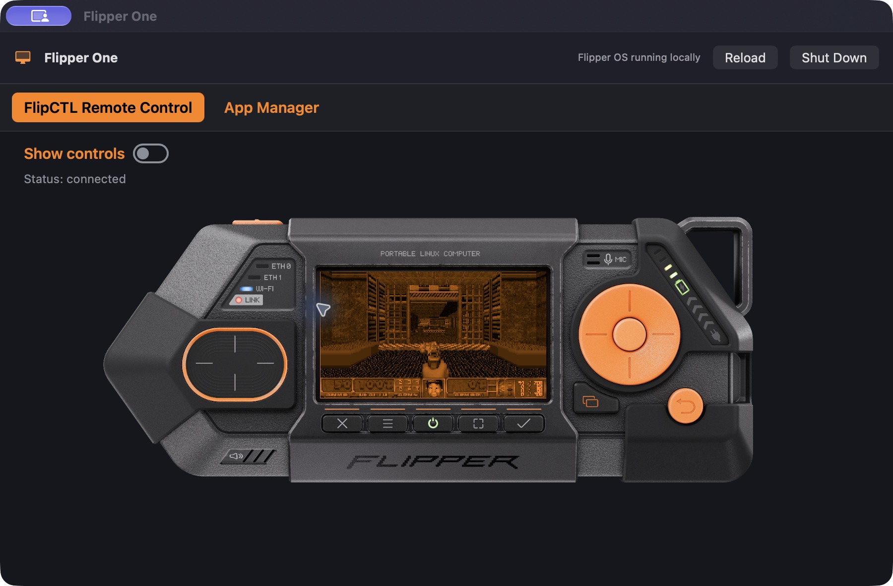
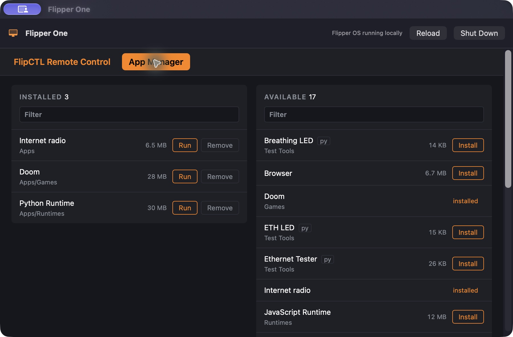
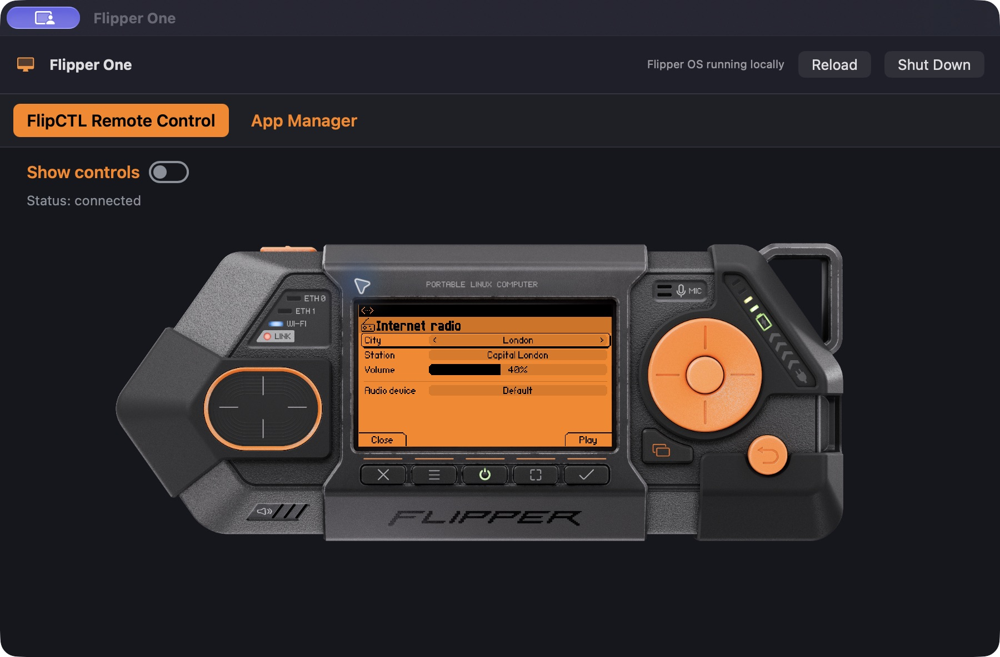

# Flipper One Mac Demo

Run Flipper OS on an Apple Silicon Mac, without a Flipper One board. This app boots a local Linux VM and puts FlipCTL in a native macOS window, with persistent storage, virtual Ethernet, and audio output through your Mac.

Free to download and use. The macOS wrapper and build scripts are open source under the [MIT License](LICENSE).

**[Download v0.1.2](https://github.com/Nirbhik-Acharya-official/flipper-one-mac-demo/releases/tag/v0.1.2)** · [Screenshots](#screenshots) · [Build from source](#build-from-source)



*Doom running in the macOS app through FlipCTL's remote-control interface.*

This is an unofficial software demo, not a full Flipper One hardware emulator or a native macOS port of Flipper OS. The device artwork above is part of FlipCTL's interface. This project is not affiliated with Flipper Devices.

## Install

You need an **Apple Silicon Mac** and at least **12 GB of free storage**. The app targets macOS 13 or later; testing so far has been on macOS 27.0.1. Intel Macs are not supported by this build.

1. Download `Flipper-One-Mac-Demo.dmg` from [Releases](https://github.com/Nirbhik-Acharya-official/flipper-one-mac-demo/releases).
2. Open the DMG and drag **Flipper One Mac Demo.app** into **Applications**.
3. Launch the app. The first start unpacks the included guest disk and can take a few minutes.
4. Open **App Manager** to install or run guest apps.
5. When finished, click **Shut Down** and wait for **Stopped**.

The installer includes the guest image and boot files. You do not need UTM, Docker, or a separate Linux download. The VM uses 2 GB of RAM, 2–4 virtual CPUs, and a 10 GB virtual disk. Guest apps can access the internet through NAT.

**macOS security:** the app is ad-hoc signed, not Apple notarized. If Gatekeeper blocks it, and you trust the build, use Finder's **right-click → Open** or the offered option in **System Settings → Privacy & Security**. Do not disable Gatekeeper globally.

**Updating:** shut down the old version before replacing it. Keep your existing guest disk—installed apps and files carry over. Version 0.1.2 adds virtual audio output, Doom audio fixes, safer VM lifecycle handling, and viewer reload/retry controls.

## Screenshots

These are captures of the running macOS app, not mockups. Click an image to view it at full size.

| App Manager | Internet Radio |
| --- | --- |
| [](assets/screenshots/app-manager.jpg) | [](assets/screenshots/internet-radio.jpg) |
| Browse the catalog and launch installed apps. | The radio app's station and volume controls. |

## Inspiration

Thanks to **[Talking Sasquach](https://www.youtube.com/@TalkingSasquach)** for the idea. His video, **[I Built a Flipper One Emulator for Windows (And It Works!)](https://youtu.be/6YfpFi8XCz8)**, inspired this macOS version.

[](https://youtu.be/6YfpFi8XCz8)

## What works—and what needs hardware

Guest boot, the FlipCTL viewer, App Manager, and Doom gameplay have been checked locally. A guest WAV played successfully, and Doom produced an active stereo stream through the virtual sound card. System Monitor, Uptime, Ping, Browser, and Internet Radio have also passed launch smoke checks.

This is still a demo. Those checks do not cover the full app catalog, every radio station, audio quality, or every control in each app.

- **Graphics:** hosted apps use software rendering rather than the Rockchip GPU.
- **Audio:** playback goes to your Mac's default output device. No microphone is exposed.
- **Networking:** virtual Ethernet provides NAT internet access. Wi-Fi and cellular scanning require real radios.
- **Board features:** MCU, GPIO, LEDs, USB gadget/controller modes, and physical cable diagnostics are not emulated.

Only the upstream image's `@Minimal` profile is supported. Automatic viewer discovery currently expects the `192.168.64.0/24` NAT subnet.

## Build from source

Building requires an Apple Silicon Mac, Xcode command-line tools, a running Docker installation, `zstd`, `xz`, internet access, and room for several large intermediate images. Docker and the compression tools are **builder-only dependencies**.

From the repository root:

```sh
bash Tools/prepare-guest.sh
bash Tools/package.sh
hdiutil verify dist/Flipper-One-Mac-Demo.dmg
codesign --verify --strict 'build/dmg-root/Flipper One Mac Demo.app'
```

If needed, install Apple's command-line tools with `xcode-select --install` first. The finished installer is `dist/Flipper-One-Mac-Demo.dmg`; it is ad-hoc signed, not notarized.

<details>
<summary>Build pipeline and pinned image</summary>

`prepare-guest.sh` downloads official image build **2413**, checks its SHA-256, and uses a privileged build-time Debian container to add a compatible ARM64 kernel and guest services. Rerunning it recreates the prepared build image.

`patch-initrd.sh` adds boot-time compatibility settings for runtime directories, software rendering, and audio. This also applies the fixes to existing guest disks without a reset.

`package.sh` compiles the Swift app, embeds the boot files and XZ-compressed guest archive, signs the bundle, and creates the DMG.

```text
Image:   debian-512-nobootloader-2413.img.zst
SHA-256: 36b0c6bf504b2b8400da25e136807a5e223a21b99657d9e623b9489e55e0b0aa
```

`.artifacts/`, `build/`, and `dist/` are ignored by Git. Publish installers as release assets. Never package a user's guest disk from Application Support; use the prepared build image.

</details>

## Troubleshooting

| Problem | Try this |
| --- | --- |
| First launch is slow | Let extraction finish and check free storage. |
| Blank or disconnected viewer | Wait for boot to finish, check **Boot log**, then click **Reload**. |
| No audio | Check guest volume/mute, Mac volume, and your Mac's selected output device. |
| Doom fails on an older version | Update to 0.1.2 and restart the guest. There is no need to reset the disk. |
| Shutdown times out | Retry **Shut Down** or use the guest OS shutdown command. Avoid force-quitting during disk writes. |
| A board diagnostic fails | Check whether it needs hardware that the VM does not expose. |

For a bug report, include the app version, Mac model, macOS version, guest app, reproduction steps, and relevant boot-log excerpts. Remove private information first. Do not upload your guest disk.

## Guest data

Your guest disk lives at:

```text
~/Library/Application Support/Flipper One Mac/guest.img
```

Deleting the macOS app does not delete this disk. It can contain private files or credentials; shut down the guest before backing it up.

The viewer uses HTTP over the private virtual network. The guest can access the internet, and this demo is not intended as a security sandbox for untrusted images or apps.

## Credits and licensing

The macOS wrapper and build scripts use the [MIT License](LICENSE). Flipper OS, Debian, FlipCTL, bundled packages and firmware, and the supplied icon retain their own licenses and redistribution requirements. The wrapper's MIT license does not relicense those components.

Flipper names and imagery belong to their respective owners. The icon is used for this demo, not offered as a general-purpose brand asset.

- [Talking Sasquach's original video](https://youtu.be/6YfpFi8XCz8)
- [FlipCTL](https://github.com/flipperdevices/flipctl-slint)
- [Flipper One development log](https://docs.flipper.net/one/dev-log/10)
- [Official Linux images](https://dl-linux-images.flipp.dev/full-img/)
- [Flipper One Linux build scripts](https://github.com/flipperdevices/flipperone-linux-build-scripts)
